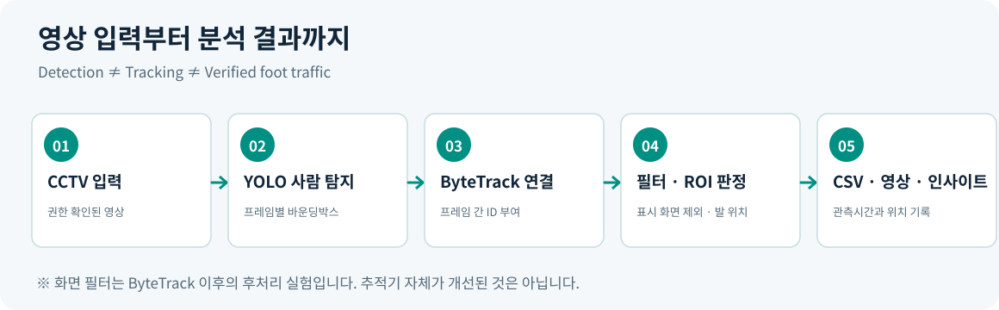
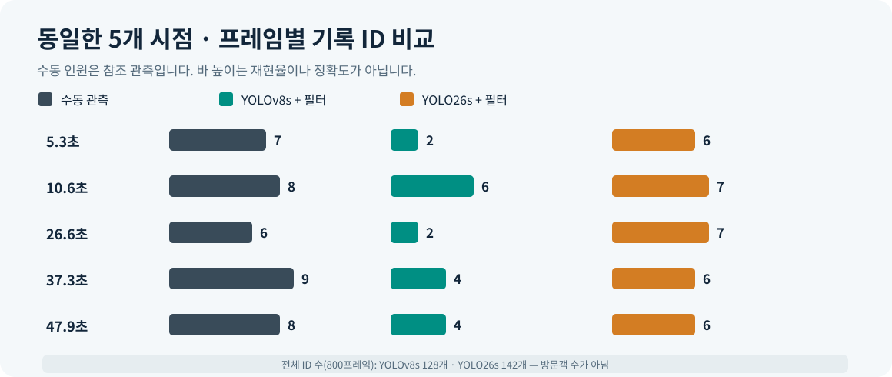

# StoreFlow | CCTV 기반 유동인구·체류 관측 MVP

**Comento · Week 4** · Python / OpenCV / Ultralytics YOLO / ByteTrack

> **목표:** 사람들이 **어디에 머무르고**, **어느 방향으로 이동하며**, **특정 구역에 언제 몰리는지** CCTV 영상으로 관찰하고 싶었습니다. 실제 방문객 수를 검증한 완성형 매장 분석 서비스가 아니라, 그 분석을 위한 **구현 및 신뢰성 검증 MVP**입니다.



## 무엇을 만들었나요?

한 대의 고정 CCTV 영상을 입력받아 사람을 탐지하고, 프레임 사이에서 사람별 ID를 연결해 **위치·방향·관측시간**을 기록합니다. 사용자가 지정한 관심 구역(ROI)에 대해 관측 정보를 집계하고, 주석 영상과 CSV, 로컬 대시보드를 출력합니다.

| 구성 | 역할 |
|---|---|
| **YOLOv8 / YOLO26** | 프레임마다 사람의 위치 탐지 (`class=person`) |
| **ByteTrack** | 연속된 장면에서 사람별 ID를 연결해 이동 정보를 추정 |
| **ROI 분석** | 사용자가 정의한 구역 내 관측 인원·관측 시간 계산 |
| **Screen filter (실험)** | 키오스크 디스플레이 안의 인물 이미지를 통계에서 제외 |
| **CSV + 시각화** | 움직임 기록, 주석 영상, 오프라인 대시보드 |

**주의:** ID 개수는 고유 방문객 수가 아닙니다. 관측 시간도 실제 매장 체류시간과 같지 않습니다.

## 실제 실험에서 확인한 것

고정 키오스크 영상 **896×672 / 15 FPS / 800프레임(약 53.3초)**으로 실험했습니다. 영상의 출처·이용 권한이 정리되지 않아 **원본 영상과 프레임 캡처는 공개 저장소에 포함하지 않았습니다.**



동일한 5개 시점에서, **필터 적용 후** 추적 ID 기록 수 합계는 YOLOv8s **18개**, YOLO26s **32개**였습니다(수동 확인 사람 관측 38건). 이는 탐지 재현율이나 정확도가 아닙니다. YOLO26s의 **최종 성능 우위는 검증되지 않았습니다.**

키오스크 화면 속 인물이 실제 사람처럼 집계되는 문제도 발견했습니다. 사후 필터 적용으로 확인된 화면 오탐 ID **3개(51·54·307)**에 해당하는 **211개 CSV 관측 행**을 제외했습니다. 필터로 ByteTrack 자체가 개선된 것은 아닙니다.

**[실험 근거·한계·그림 자세히 보기 → docs/README.md](docs/README.md)**

## 실행 방법

Python 3.10 이상을 권장합니다. 인터넷 연결이 필요한 경우 YOLO 가중치가 처음 실행할 때 다운로드될 수 있습니다.

```bash
cd 4week
python3 -m venv .venv
source .venv/bin/activate        # Windows: .venv\Scripts\activate
python -m pip install -r requirements.txt
python -m pytest -q
```

**직접 이용할 권한이 있는 영상**을 `samples/my_video.mp4`에 두고 실행하세요. 다음 명령은 디스플레이 필터를 끈 일반 실행 예시입니다.

```bash
python storeflow_mvp.py \
  --input samples/my_video.mp4 \
  --output-dir outputs/baseline \
  --model yolo26s.pt --conf 0.15 --imgsz 960
```

특정 **896×672 키오스크 실험 영상에서만** 검토된 화면 필터 실험:

```bash
python storeflow_mvp_screenfilter.py \
  --input samples/my_video.mp4 \
  --output-dir outputs/screenfilter_trial \
  --model yolo26s.pt --conf 0.15 --imgsz 960 \
  --filter-kiosk-screen
```

화면 필터는 좌표가 고정된 **실험 전용 코드**입니다. 다른 영상에 그대로 적용하면 실제 사람을 제외할 수 있습니다. 이 옵션 없이 실행하면 일반적인 추적 결과를 얻습니다.

ROI·대시보드는 아래 명령으로 사용법을 확인할 수 있습니다. 영상에 맞는 ROI를 **먼저 직접 설정·검증**해야 합니다.

```bash
python storeflow_roi.py --help
python storeflow_dashboard.py --help
```

## 프로젝트 구조

```text
4week/
├── README.md                    # 이 문서: 목적·사용법·검증 범위
├── requirements.txt
├── .gitignore
├── storeflow_mvp.py             # YOLO + ByteTrack 기본 실행
├── storeflow_mvp_screenfilter.py # 디스플레이 오탐 사후 필터 실험
├── storeflow_roi.py             # ROI 설정·관측 통계
├── storeflow_dashboard.py       # 로컬 대시보드
├── gate_runner.py               # 단계별 검증
├── tests/ + test_*.py           # 자동 테스트
└── docs/
    ├── README.md                # 실험 근거·설명·한계
    └── assets/                  # 원본 CCTV가 아닌 자체 제작 SVG 도식
```

## 결과를 해석할 때 주의할 점

- **자료의 한계:** 공개 영상 후보 중 접근·이용 조건과 카메라 구도가 목표에 맞는 장시간 매장 영상을 확보하지 못했습니다. 현재 영상은 매장 전체나 출입구를 보여주지 않습니다.
- **기술의 한계:** 실제 사람 누락, 화면 속 이미지 오탐, ID 단절·변경 가능성, ROI 미검증이 남아 있습니다.
- **따라서 주장하지 않는 것:** 실제 방문객 수, 하루 유동인구, 정확한 주문 대기시간·체류시간, 구매 전환율, YOLO26의 확정적인 정확도 우위.

> **한 줄 결론:** 좋은 모델만으로 원하는 인사이트를 얻을 수는 없었습니다. **분석 목적에 맞는 영상 확보 → 사람 인식·ID 안정성 검증 → 구역 정의**가 먼저 필요합니다.

수치·실험 조건·한계는 [docs/README.md](docs/README.md)에 명시했습니다. 이 프로젝트는 교육용 시연 결과이며 운영 의사결정이나 자동 감시에 바로 사용하기에 적절하지 않습니다.
