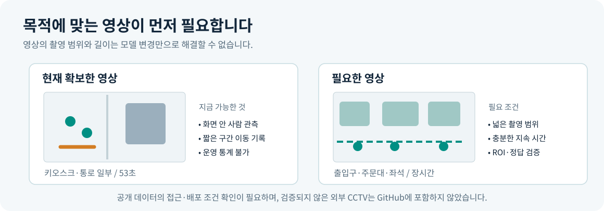
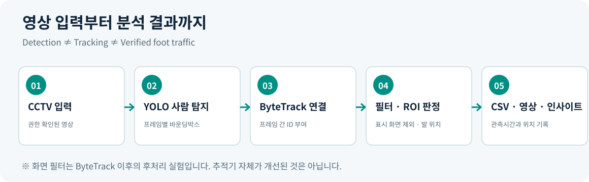
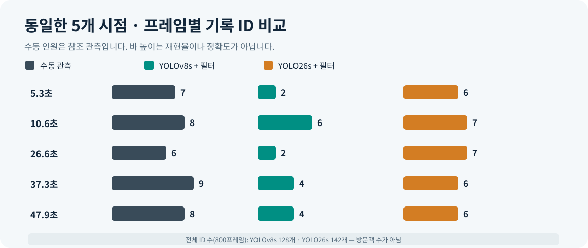
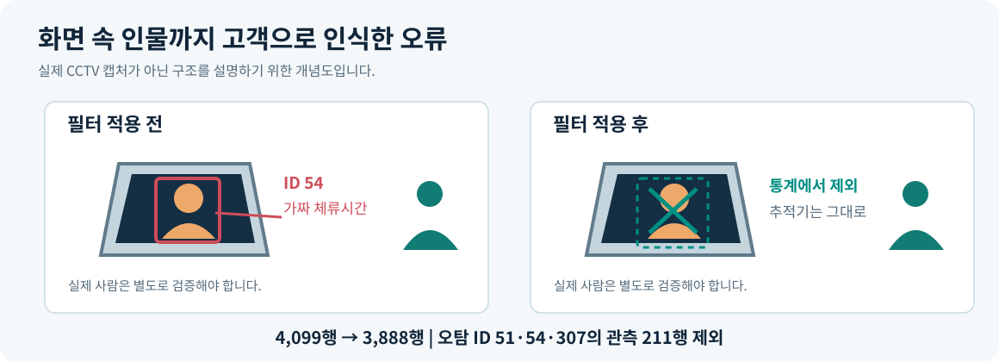
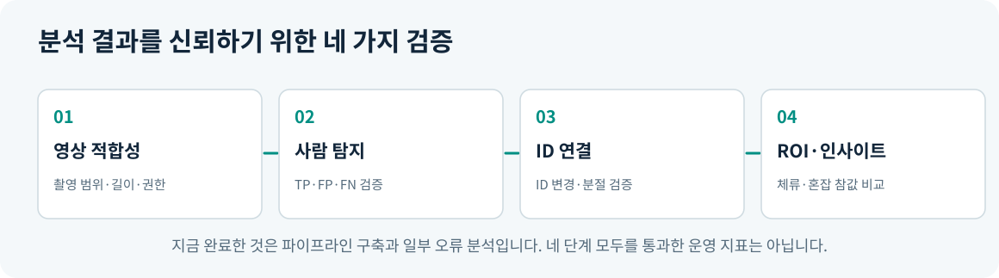

# StoreFlow · 설계와 검증 기록

[← 프로젝트 소개 및 실행](../README.md)

## 01. 얻고 싶었던 인사이트

> 사람들이 **어느 공간에 머무르는지**, 유동인구가 **어떻게 이동하는지**, 특정 구역에 **언제 모이는지** 알아보고 싶었습니다.

이를 통해 매장의 출입·주문대·좌석 구역의 혼잡과 공간 동선을 비교하는 것을 목표로 했습니다. 단, 이러한 판단을 하려면 **출입구 및 주요 구역이 보이는 충분히 긴 영상**, 구역별 참값, 안정적인 ID 연결이 필요합니다.

### 왜 키오스크 영상을 사용했나요?

조사한 공개 영상 후보 중 일부는 다운로드나 접근이 어려웠고, 사용 조건을 명확히 확인하기 어렵거나 매장 전체 관측에 적합하지 않았습니다. 따라서 확보해 분석할 수 있었던 **896×672, 15 FPS, 800프레임(약 53.3초)**의 키오스크·통로 영상으로 **기능과 오류를 검증하는 범위**로 축소했습니다.

## 02. 시스템 구조와 모델 선택

**왜 YOLO를 사용했나요?** 별도 모델 학습을 하지 않고도 사전학습된 사람 탐지 모델로 각 프레임의 사람 위치(박스)를 얻어 초기 MVP를 빠르게 구성하기 위해서입니다. YOLO가 다른 모든 모델보다 우수하다는 비교 결과는 없습니다.

**왜 ByteTrack을 사용했나요?** YOLO는 한 장면의 위치만 알려주므로, 여러 프레임에서 같은 사람으로 보이는 관측을 ID로 연결해 이동 방향·관측시간을 계산하기 위해 사용했습니다. ID가 실제 신원이나 고유 방문객 수를 보장하지는 않습니다.

**왜 YOLOv8n → YOLOv8s → YOLO26s로 실험했나요?** 초기 기본 설정에서 실제 사람이 기록되지 않는 장면이 발견됐기 때문입니다. YOLOv8s 변경 시 모델 크기뿐 아니라 해상도(640→960)와 confidence(0.25→0.15)를 **함께** 변경했습니다. 개별 변경 효과를 분리하지 못했습니다. 이후 같은 설정으로 YOLO26s를 비교했습니다.

로직: `영상 → YOLO 탐지 → ByteTrack ID 연결 → (선택) 디스플레이 사후 필터 → 발 위치·구역 판정 → 관측 CSV·주석 영상 → ROI 집계·로컬 대시보드`

## 03. 동일 장면 관측 비교

| 영상 시점 | 수동 관측 인원* | 초기 YOLOv8n 기록 ID | YOLOv8s + 화면 필터 기록 ID | YOLO26s + 화면 필터 기록 ID |
|---|---:|---:|---:|---:|
| 5.3초 | 7 | 0 | 2 | 6 |
| 10.6초 | 8 | 3 | 6 | 7 |
| 26.6초 | 6 | 1 | 2 | 7 |
| 37.3초 | 9 | 2 | 4 | 6 |
| 47.9초 | 8 | 0 | 4 | 6 |
| **합계** | **38** | **6** | **18** | **32** |

*동일 사람이 여러 시점에 나타날 수 있으며 38은 고유 방문객 수가 아닙니다.

- **YOLOv8n 기본:** `yolov8n.pt`, `imgsz=640`, `conf=0.25`, ByteTrack, 화면 필터 없음.
- **YOLOv8s / YOLO26s:** 각각 `yolov8s.pt` 및 `yolo26s.pt`, `imgsz=960`, `conf=0.15`, ByteTrack, **동일한 화면 사후 필터**.
- 수치들은 특정 시점에 기록된 **ID 개수**입니다. 사람 수와 정확히 일치하지 않을 수 있어 재현율·F1·정확도 개선율로 해석하면 안 됩니다.
- YOLO26s가 더 많은 ID를 기록했어도 오탐과 ID 분절 가능성이 있으므로 **가장 정확한 모델로 판정하지 않았습니다.**

## 04. 화면 속 사람을 실제 사람처럼 기록하는 오류

키오스크 화면에 표시된 사람 이미지가 YOLO의 `person` 박스로 탐지되어 ByteTrack에서 ID를 받는 문제가 있었습니다. 이 경우 **실제 이용자가 아닌 화면 이미지에 가짜 체류시간이 축적**됩니다.

YOLOv8s로 동일한 영상을 처리하고, 후처리 단계에서 **디스플레이 표시 영역에 대부분 포함된 박스**를 통계에서 제외했습니다. 3개 ID(51, 54, 307)를 비교 영상에서 디스플레이 오탐으로 확인했습니다.

| 항목 | 필터 전 | 필터 후 | 해석 |
|---|---:|---:|---|
| CSV 관측 행 | 4,099 | 3,888 | **211행 제외**, 인식 정확도 향상률이 아님 |
| CSV에 등장한 ID 종류 | 131 | 128 | 고유 방문객 수가 아님 |
| 화면 오탐 ID 51 | 2행 | 0행 | 화면 이미지로 확인 |
| 화면 오탐 ID 54 | 191행 | 0행 | 화면 이미지로 확인 |
| 화면 오탐 ID 307 | 18행 | 0행 | 화면 이미지로 확인 |

## 05. 아직 도달하지 못한 목표

| 원래 알고 싶었던 정보 | 현재 상태 | 부족한 조건 |
|---|---|---|
| 매장 전체의 유동인구 | **미검증** | 출입구·전체 동선을 포함하는 장시간 영상 |
| 구역별 체류 패턴 | **프로토타입** | 적합한 ROI, ID 유지 검증, 실제 구역별 정답 |
| 시간대별 혼잡도 | **분석 불가** | 53초가 아닌 긴 관측 시간 |
| 키오스크 A/B별 이용률 | **미검증** | 두 키오스크의 정확한 구역·사용 행동 기준 |
| 화면 오탐 제외 | **일부 검증** | 특정 3개 ID 제거 확인; 다른 장면의 누락 여부 미검증 |
| 모델의 실제 인식 정확도 | **미검증** | 위치 박스 정답과 IoU 매칭, 동일한 검증 조건 |

### 다음에 개선한다면

1. **데이터:** 공개·배포·분석 권한이 명확하고 출입구/관심 구역이 충분히 보이는 장시간 영상 확보
2. **탐지:** 동일한 GT 바운딩박스로 TP·FP·FN, Precision·Recall·F1 평가
3. **ID 연결:** 시간 연속성이 있는 ID 정답을 만들어 ID switch, fragmentation 평가
4. **분석:** 검증된 ROI를 정의하고 체류·혼잡 추정과 실제 관측 결과 비교
