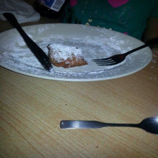
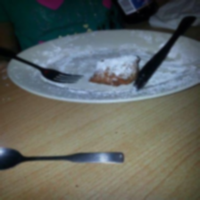
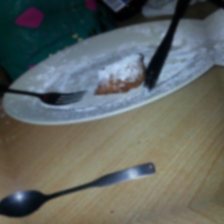
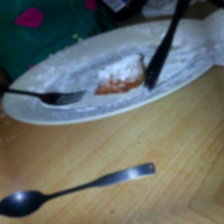
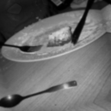
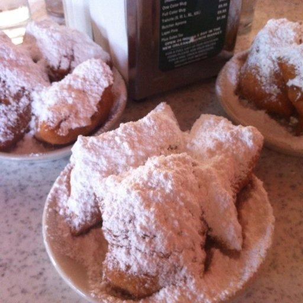
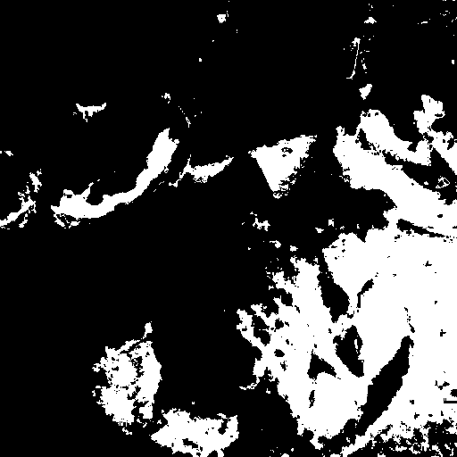
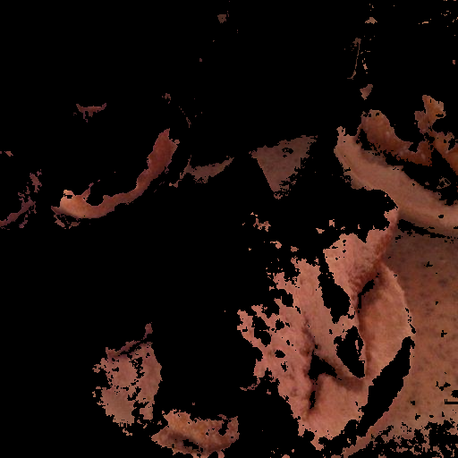
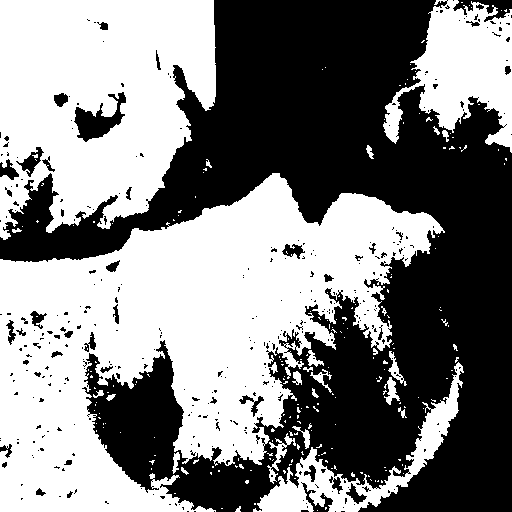

# Comento Week 1 — Git과 픽셀 단위 이미지 처리

업무요청서 6–12페이지의 1차 업무를 구현했다. Python·OpenCV·NumPy로 빨간색 검출, 이미지 전처리, 제한된 이상치 필터링을 수행한다. 모델 학습·OCR·서버·UI는 이번 범위에 포함하지 않는다.

**현재 상태:** 이미지 처리 실행과 29개 자동검증 완료. 로컬 Git 저장소와 커밋 완료. 원격 저장소 생성 여부는 본인 GitHub에서 확인해야 한다. 원격 Push·PR·외부 리뷰·Merge는 미완료이며 [Git 상태와 후속 명령](docs/git_status.md)에 구별해 기록했다.

## 프로젝트 구조와 유지 이유

```text
image_preprocessing.py    # 핵심 구현: 색상 검출·전처리·이상치 판정
requirements.txt          # 설치 의존성
README.md                 # 실행·설계 설명
.gitignore                # 임시 파일 제외
.git/                     # Git 브랜치·커밋 이력 (ZIP에서 유지, GitHub PR에는 자동 비노출)
data/
  originals/              # Food101 원본 5장: 재현 가능한 입력
  source_manifest.json    # 출처·SHA256 정보
preprocessed_samples/     # PDF에 명시된 제출용 이미지 5장
results/
  color_detection/        # sample_02의 대표 색상 검출 사례 4장
  demo/                   # 전처리 순서별 대표 이미지 6장
  normalized/             # 5장 float32 학습 입력 배열 (.npy)
  accepted/               # 이상치 필터 통과 2장 (.npy)
  outlier_examples/       # 이상치 조건 확인용 합성 이미지 3장
  metrics.json            # 원본 분석값·정규화 출력 요약
  outlier_decisions.json  # 원본 5장과 합성 입력의 통과/제외 판정
scripts/                  # Food101 다운로드·검증 재현 도구
tests/                    # 단위 테스트 29개
submission/               # 제출용 3장 PPT
docs/                     # 요구사항 추적·Git·PR·검증 설명
```

중복 이미지(`color_detection`의 다른 4개 샘플)는 제출본에서 제외했다. 다만 실행하면 모든 샘플의 검출 이미지가 자동 생성된다. `docs/evidence/`의 로그와 `results/run_summary.json`도 실행할 때 새로 생성되며 Git에서 추적하지 않는다. **이미지 처리 로직 자체는 변경하지 않았다.**

## 1. 요구사항과 구현

공식 항목 25개와 사용자 품질 조건을 [요구사항 추적표](docs/requirements_traceability.md)로 연결했다.

| 구분 | 구현 |
|---|---|
| 필수 픽셀 처리 | 이미지 로드, 중심 픽셀·채널별 평균, BGR→HSV, 빨간색 검출·필터링, 밝기 이진화 |
| 기본 추가 | Hugging Face 이미지 5장, 224×224, Blur, 좌우 반전, 회전, 색상 변화, Grayscale, Normalize |
| 심화 | 평균 밝기와 가장 큰 빨간 연결 영역의 비율을 계산하고 조건 미달 샘플 제외 |
| 제출 | image_preprocessing.py, preprocessed_samples/ 5장, README, 3페이지 PPT |

## 2. 실행 환경

실제로 검증한 환경은 Linux x86_64, Python **3.12.14**, OpenCV **4.11.0**, NumPy **2.2.6**이다. 설치 패키지 이름은 `opencv-python-headless==4.11.0.86`이다. GUI 창 대신 파일로 결과를 저장한다. macOS·Windows에서의 실행은 이번 환경에서 검증하지 않았다.

```bash
python3 -m venv .venv
source .venv/bin/activate
python -m pip install -r requirements.txt
```

## 3. 실행 명령

현재 디렉터리를 이 README가 있는 프로젝트 루트로 두고 실행한다. 원본 5장과 출처 기록이 포함되어 있어 **기본 실행에는 Hugging Face 접속이 필요 없다.**

```bash
python image_preprocessing.py
python -m unittest discover -s tests -v
```

별도 디렉터리에 같은 결과를 만들려면 다음 명령을 사용한다.

```bash
python image_preprocessing.py --output-dir artifacts/reproduced
```

Hugging Face에서 같은 원본을 다시 받는 선택 명령:

```bash
python scripts/download_samples.py
```

다운로더는 공개 Dataset Viewer API의 Food101 `train` 행 0–4를 받아온다. 데이터셋 revision `83488de741c1bd1ce27aa6a2b33e19c7bdf92ca9`와 이미지 SHA256이 바뀌면 덮어쓰지 않고 중단한다. 캐시 URL의 만료나 외부 API 장애 시에는 포함된 원본을 사용한다. 현재 5장은 모두 `beignets` 클래스이므로 데이터셋 전체를 대표하는 표본은 아니다. 출처: [Food101](https://huggingface.co/datasets/ethz/food101), [공식 rows API 문서](https://huggingface.co/docs/dataset-viewer/rows), [로컬 출처 기록](data/source_manifest.json). Food101 카드의 라이선스 표기는 `unknown`이며 데이터 이미지에 별도 코드 라이선스를 부여하지 않는다.

## 4. 전처리 순서

`원본 BGR → 224×224 → Gaussian Blur → 좌우 반전 → +15° 회전 → HSV 색상 변화 → Grayscale → Normalize`

| 단계 | 실제 설정 / 출력 |
|---|---|
| Resize | INTER_AREA, 224×224. 비율 유지 없이 정사각형으로 바꾸므로 원본 형태가 왜곡될 수 있음 |
| Blur | Gaussian 5×5, σ=1.0, BORDER_REFLECT_101 |
| Flip | cv2.flip(image, 1), 열 순서 반전 |
| Rotate | 중심 (111.5, 111.5), 반시계 +15°, 선형 보간, 반사 경계 |
| Color | HSV 채도 ×1.25, 명도 ×1.10, 반올림·0–255 제한 후 BGR 복귀 |
| Grayscale | BGR→GRAY, (224, 224) uint8 단일 채널 |
| Normalize | gray.astype(float32) / 255.0, (224, 224), [0, 1] |

색상 증강은 **Grayscale 이전** 컬러 이미지에 수행한다. 중간 결과는 서로 독립적으로 합성한 사진이 아니라, 같은 파이프라인의 순차 단계다. 변환값이 고정되어 난수 시드가 필요 없다. Blur는 합성 impulse에서 실제 확산·최대값 감소를 검증했다. 실제 사진의 노이즈 제거 성능을 정량 입증한 것은 아니다.

정규화 실수 배열은 `results/normalized/*.npy`에 보존한다. `preprocessed_samples/*.png`는 `round(normalized * 255)`로 되돌린 **uint8 시각화**다. PNG가 [0,1] float32 배열 자체를 저장한다고 해석하면 안 된다. 따라서 최종 PNG는 Grayscale 단계와 시각적으로 같다.

## 5. 색상 검출과 밝기 Threshold

OpenCV의 uint8 HSV Hue는 **0–179**다. 빨간색은 H=0–10 또는 170–179, S≥120, V≥70인 픽셀로 정한다. 양끝 마스크를 `cv2.bitwise_or`로 합쳐 `bitwise_and`로 원본에서 해당 색상만 남긴다. 읽기·저장·수치 분석은 BGR 기준이며 RGB 배열로 오해하지 않는다.

`cv2.threshold()`는 Grayscale 밝기 **127 초과**인 픽셀을 255로 바꾸고 나머지를 0으로 만든다. 이는 빨간색 여부를 판단하는 HSV 마스크와 목적이 다르다. 예를 들어 순수 빨강 BGR(0,0,255)은 색상 마스크에서 선택되지만 밝기 이진화에서 0이며, 흰색은 그 반대다. 두 결과를 모두 `results/color_detection/`에 저장한다.

## 6. 이상치 판정과 실제 제외

판정은 증강 전 원본 해상도에서 수행한다.

- 어두움: `mean(cv2.cvtColor(BGR, COLOR_BGR2GRAY)) < 50.0`. 각 픽셀의 8비트 Grayscale 값을 산술 평균하며, 평균 50은 통과한다. HSV V 평균이나 물리적인 조도(lux)는 아니다.
- 작은 빨간 영역: 8방향 연결 요소 중 최대 **픽셀 수 / 이미지 전체 픽셀 수 < 0.05**. 정확히 5%이면 통과한다. Contour의 사각형 면적이나 모든 빨간 픽셀의 합을 쓰지 않는다.
- 둘 중 하나라도 해당하면 제외한다. 실제 통과 배열만 `results/accepted/`에 저장한다. 기본 입력에서는 sample_02·04만 통과해 2장이고, 01·03·05는 작은 빨간 영역으로 제외되어 3장이다.

이 크기 판정은 **검출된 빨간 영역의 크기만** 측정한다. 큰 음식이라도 빨강이 없으면 제외될 수 있고, 작은 빨간 물체라도 배경이 빨강이면 통과할 수 있다. 음식 객체 크기의 정답이나 Food101의 일반적인 품질 판정으로 사용하지 않는다. 밝은 배경 위 어두운 물체도 평균 밝기로 놓칠 수 있다.

정답을 알고 있는 합성 입력도 제공한다. `normal`은 빨간 면적 25%, 평균 밝기 154.0으로 통과한다. `dark`는 평균 15.5로 제외되고, V<70으로 색상 검출도 사라져 작은 영역 조건에도 해당한다. `small`은 빨간 면적 1%, 평균 178.96으로 제외된다. 이미지와 판정값: `results/outlier_examples/`, `results/outlier_decisions.json`.

## 7. 실제 처리 결과

`preprocessed_samples/`의 **5장 모두** 각각 다른 원본 행에 동일한 순차 변환을 적용한 최종 Grayscale·Normalize의 시각화다. 필터 통과 목록과 구별해 전처리 과정 확인용으로 5장을 보존했다. 필터가 거부한 사진을 학습용 통과 샘플로 표시하지 않는다.

| 결과 파일 | Food101 train 행 | 원본 (H×W×C) | 정규화 최소–최대 | 빨간 최대 영역 비율 | 판정 |
|---|---:|---|---|---:|---|
| sample_01.png | 0 | 512×384×3 | 0.000000–0.839216 | 0.0214% | 제외 |
| sample_02.png | 1 | 512×512×3 | 0.070588–0.996078 | 18.1000% | 통과 |
| sample_03.png | 2 | 383×512×3 | 0.007843–1.000000 | 0.1428% | 제외 |
| sample_04.png | 3 | 348×512×3 | 0.015686–0.996078 | 6.4795% | 통과 |
| sample_05.png | 4 | 512×512×3 | 0.000000–1.000000 | 0.0134% | 제외 |

### 같은 원본의 순차 변화

| Resize | Blur | Flip |
|---|---|---|
|  |  |  |

| Rotate | Color change | 최종 Grayscale 시각화 |
|---|---|---|
|  |  |  |

### 색상 검출 (sample_02)

| 원본 | HSV 빨강 마스크 | 빨간색만 남긴 결과 | 밝기 이진화 |
|---|---|---|---|
|  |  |  |  |

## 8. 검증과 재현

`python -m unittest discover -s tests -v`의 실제 결과: **29 tests, OK**. 원본 SHA256, 최종 5장 디코드, 224×224 단일 채널, float32 범위, PNG↔NPY 수치 대응, Blur 확산, 반전 방향, 회전 위치, HSV 변화, 오류 입력, 색상·밝기·영역 임계값을 확인한다. 상세 실행 기록과 별도 경로 재현 비교는 [검증 방법](docs/verification.md)에 있다.

재현 명령의 기본 실행은 결과 디렉터리의 알려진 생성 파일을 갱신한다. 최종 이미지 폴더에 무관한 파일이 있으면 덮어쓰지 않고 오류로 중단한다. 원본 파일 손상·변경도 SHA256으로 감지한다. 모델 정확도나 일반 객체 탐지 성능은 측정하지 않았다.

## 9. 제출 및 제한

- [3페이지 발표 자료](submission/week1_report.pptx)
- [실행·검증 방법](docs/verification.md), [요구사항 추적표](docs/requirements_traceability.md)
- [저장소](https://github.com/brightlcy/comento-week1-image-processing) — 비공개이므로 멘토에게 열람 권한이 필요하다.
- [Git 미완료 단계와 후속 명령](docs/git_status.md), [PR 본문](docs/pr_description.md)

남은 외부 작업을 완료하기 전에는 전체 과제를 최종 완료로 판정하지 않는다. 다음 주차에서 색상과 무관한 객체 크기가 필요해지면 해당 주차의 객체 검출 결과로 대체할 수 있다. 이번 주차에는 그 기능을 구현하지 않았다.
